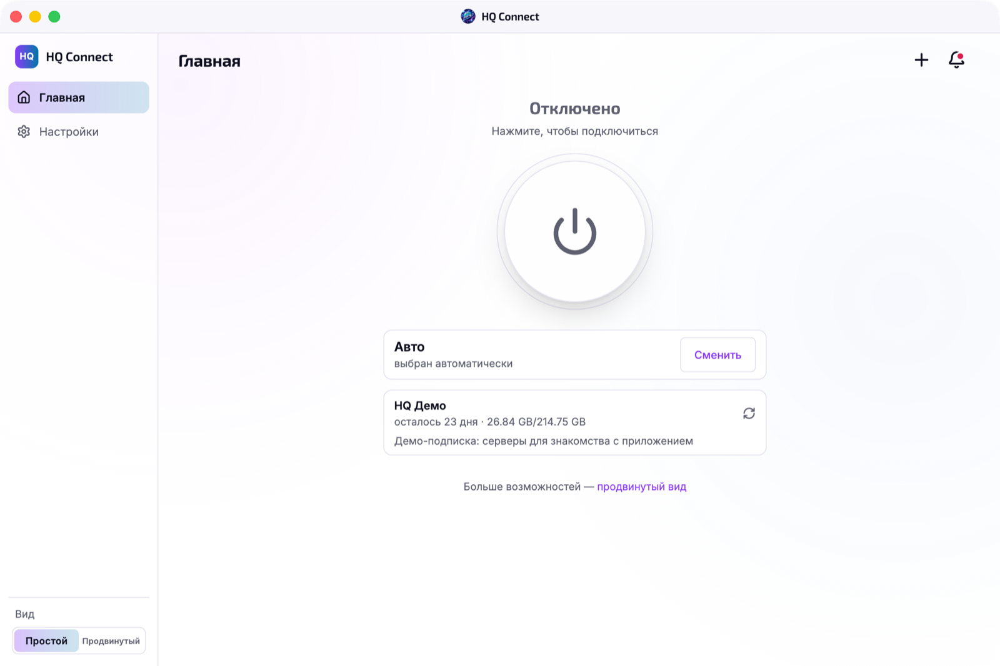
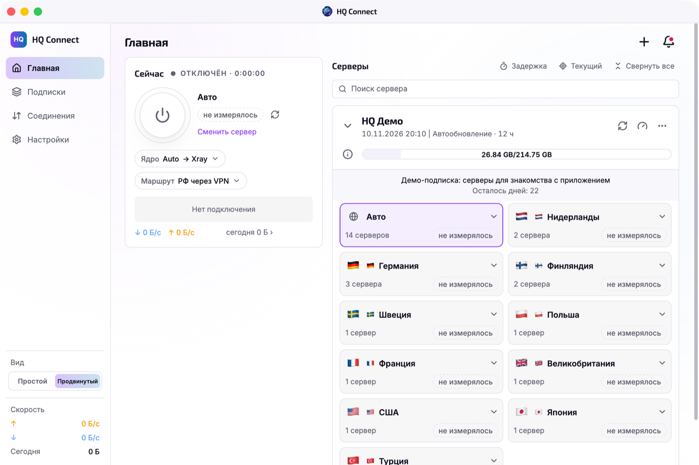
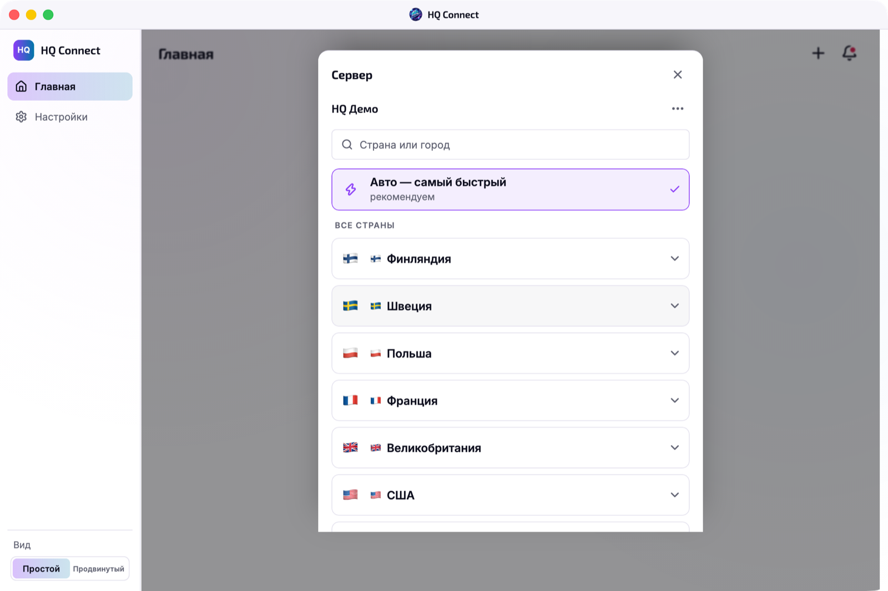
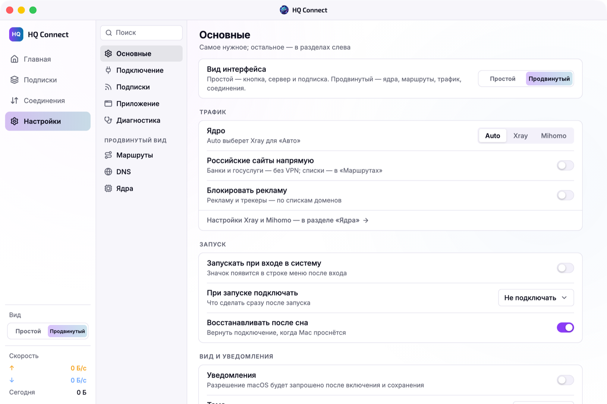

<p align="center">
  
</p>

<h1 align="center">HQ Connect</h1>

<p align="center">
  VPN-клиент для подписок Xray и Mihomo.<br>
  Одна кнопка — в простом виде, все возможности — в продвинутом.
</p>

<p align="center">
  <a href="https://github.com/qwertyhq/Hq-vpn-apps/releases/tag/macos-20261110184052.0"><b>Скачать HQ Connect 1.0</b></a>
  ·
  <a href="#установка">Установка</a>
  ·
  <a href="#вопросы">Вопросы</a>
</p>

<p align="center">
  
  
</p>

## Возможности

- **Простой и продвинутый вид.** В простом — только кнопка, сервер и подписка. В продвинутом — ядро, маршруты, трафик, соединения и список серверов. Переключаются в любой момент.
- **Два ядра: Xray и Mihomo.** VLESS (Reality, TCP, XHTTP) и Hysteria2. Ядро можно выбрать для каждой подписки или оставить «Авто».
- **Подписки.** Добавляются ссылкой, QR-кодом или файлом. Обновляются сами и показывают остаток трафика, срок и сообщения провайдера.
- **Самый быстрый сервер.** «Авто» сам выбирает сервер по задержке, а проверить задержку можно в один клик.
- **Маршруты.** Российские сайты напрямую, блокировка рекламы и свои правила для доменов и адресов.
- **Защита интернета (Mac).** Если VPN неожиданно пропадёт, интернет закроется, пока вы не нажмёте «Отключить».
- **Удобно на Mac.** Строка меню, горячие клавиши и автообновление: новые версии приложение предложит само.
- **Приватность.** Ссылки на подписку и ключи серверов хранятся только на устройстве и не попадают в журналы.

<p align="center">
  
  
</p>

## Скачать

| Платформа | Файл | Требования |
|---|---|---|
| **macOS** | [`HQConnect-1.0-mac.dmg`](https://github.com/qwertyhq/Hq-vpn-apps/releases/download/macos-20261110184052.0/HQConnect-1.0-mac.dmg) | Apple Silicon, macOS 14 и новее |
| **Android** | [`HQConnect-1.0-android.apk`](https://github.com/qwertyhq/Hq-vpn-apps/releases/download/macos-20261110184052.0/HQConnect-1.0-android.apk) | Android 7.0 и новее, arm64 |
| **Windows** · ранний доступ | [`HQConnect-1.0-windows-x64.zip`](https://github.com/qwertyhq/Hq-vpn-apps/releases/download/macos-20261110184052.0/HQConnect-1.0-windows-x64.zip) | Windows 10/11, x64, права администратора |
| **Linux** · ранний доступ | [`HQConnect-1.0-linux-x64.tar.gz`](https://github.com/qwertyhq/Hq-vpn-apps/releases/download/macos-20261110184052.0/HQConnect-1.0-linux-x64.tar.gz) | x86_64, systemd |

Все файлы — в [релизе 1.0](https://github.com/qwertyhq/Hq-vpn-apps/releases/tag/macos-20261110184052.0). Контрольные суммы — в `SHA256SUMS.txt` там же.

## Установка

### macOS

1. Откройте `HQConnect-1.0-mac.dmg` и перетащите «HQ Connect» в «Программы». Запускайте из «Программ», не из DMG — если запустить из DMG, приложение само предложит перенестись.
2. Сборка не нотарифицирована Apple. Если macOS не даёт открыть приложение: «Системные настройки» → «Конфиденциальность и безопасность» → «Всё равно открыть».
3. Нажмите «Подключить» и разрешите фоновый объект HQ Connect: «Системные настройки» → «Основные» → «Объекты входа и расширения».
4. Добавьте подписку и подключитесь.

Дальше приложение обновляется само.

### Android

1. Скачайте `HQConnect-1.0-android.apk` на телефон и откройте его. Разрешите установку из этого источника, если Android спросит.
2. Добавьте подписку и при первом подключении разрешите создать VPN.

Сборка подписана тестовым ключом. Если раньше стояла тестовая версия HQ Connect, сначала удалите её.

### Windows (ранний доступ)

1. Распакуйте `HQConnect-1.0-windows-x64.zip` целиком.
2. Откройте PowerShell от имени администратора, перейдите в распакованную папку и запустите:
   ```powershell
   powershell -ExecutionPolicy Bypass -File .\install.ps1
   ```
   Установщик кладёт приложение в `C:\Program Files\HQ Connect` и регистрирует службу, которая включает VPN. Служба пускает к себе только это приложение и только пользователя, который вошёл в Windows.
3. Запустите HQ Connect из меню «Пуск», добавьте подписку и подключитесь.

Обновление — запустить `install.ps1` новой версии, удаление — `uninstall.ps1`. Сборка не подписана сертификатом Microsoft, поэтому Windows может предупредить при запуске.

### Linux (ранний доступ)

1. Распакуйте архив: `tar -xzf HQConnect-1.0-linux-x64.tar.gz && cd HQConnect-1.0-linux-x64`
2. Установите от своей учётной записи:
   ```sh
   sudo ./install.sh
   ```
   Нужны systemd с systemd-resolved, iproute2, python3 и `/dev/net/tun` — есть в обычных Ubuntu, Debian и Fedora. Приложение ставится в `/opt/hqconnect`, служба `hqconnect-runtime` пускает к себе только его и только вашу учётную запись.
3. Запустите HQ Connect из меню приложений, добавьте подписку и подключитесь.

Обновление — снова `sudo ./install.sh` из новой версии, удаление — `sudo ./uninstall.sh`.

## Вопросы

**Где взять подписку?** У вашего VPN-провайдера: HQ Connect работает со ссылками на подписку Xray/Mihomo, а также с отдельными ключами `vless://` и `hysteria2://`.

**VPN не включается.** Пришлите номер версии («Настройки» → «Приложение»), выбранное ядро (Xray или Mihomo) и текст ошибки. Ссылку на подписку и ключи не присылайте никому.
